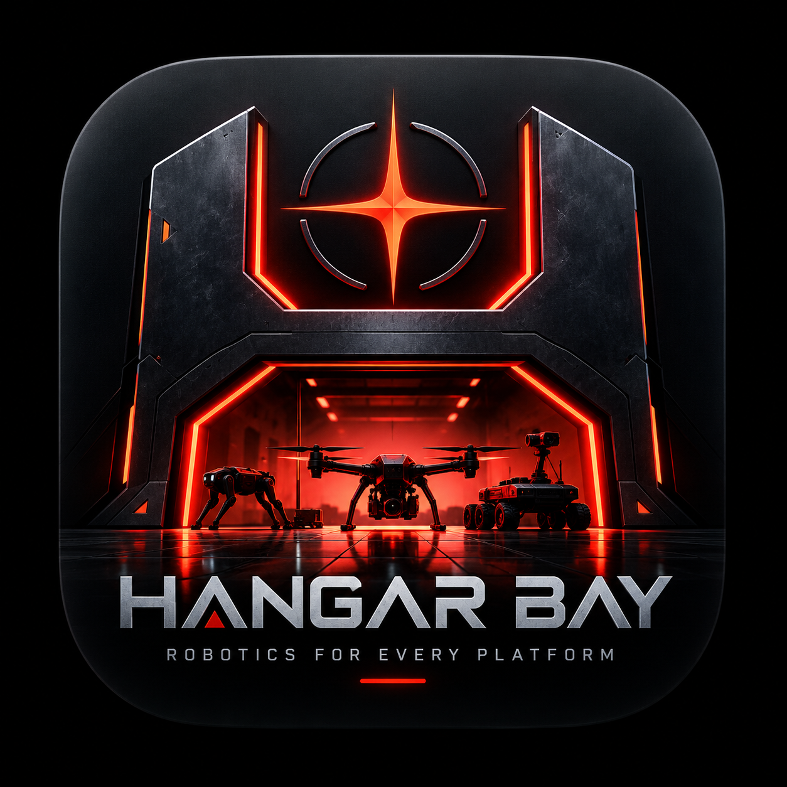

# Darkstar Robotics

<p align="center">
  
</p>

*BUILD • EXPLORE • DEPLOY*

A native macOS app (Swift + SwiftUI) — a robotics development
workstation that gives budding roboticists one friendly place for
robotics development on their MacBook:

- **Dashboard** — live state of the managed Linux runtime (UTM VM), the
  active Ubuntu/ROS/Gazebo pairing, PX4 SITL, and the Tailscale link.
- **Preflight** — a prerequisite checklist that probes this Mac and the
  runtime (memory, disk, Xcode, UTM, VM state, Tailscale, ROS 2, Gazebo,
  PX4), gives each failed item a one-click remedy where one exists, and
  lists every heavy dependency with its size, source, and download state.
- **Environments** — validated pairings (Ubuntu 24.04 + ROS 2 Jazzy +
  Gazebo Harmonic today; Ubuntu 22.04 + ROS 2 Humble next). Pick what you
  want to build, never which versions "go together".
- **Hardware** — photo/scan intake: drop a picture of a board, flight
  controller, label, or QR code and the fleet starts from what you own.
  (Recognition engine plugs in behind this intake.)
- **Missions** — the PX4 swarm-recovery golden demo with its verified
  evidence (PASS · 8.095 m min separation · 641 samples · 2 reassignments).
- **Viewer** — embedded replay/telemetry viewing.

The Linux side runs in a managed runtime under the hood (the Omega-Ubuntu
UTM VM is the working prototype, built and tuned Oct 2026). The user never
touches a terminal, an apt lock, or a version matrix.

## Run it

Open `Package.swift` in Xcode and press Run — or:

```
swift run
```

Requires macOS 14+. Settings (⌘,) holds the VM name and SSH target.
The Swift package/target is still named `RoboticsControlCenter`
internally; the product name is Darkstar Robotics (renamed from
Hangar Bay on 2026-10-23 — the GitHub repo keeps its original name
for now).

## Status

v0.3 — Darkstar Robotics rebrand, 2026-10-23. New user-supplied star
emblem logo; palette retuned to the rebrand system (Starfire #FF4A2F
primary, Ember #FF785A, Signal Cyan #00CFFF instrumentation, System
Green #28D97A verified success only, Alert Red #F64D4D errors only).
Honesty taxonomy unchanged; all runtime behavior preserved.

v0.2 — DARKSTAR design foundation, 2026-10-23 (see
`docs/DARKSTAR-UI-UX-PLAN.md`). Obsidian/gunmetal theme tokens, branded
sidebar, mission-control Dashboard, and the honesty taxonomy as a UI
component: every status is chipped LIVE, RECORDED, DEMO, PENDING, or
UNKNOWN — telemetry green means verified success only; signal red is
brand + alerts only. All v0.1 runtime behavior preserved.

v0.1 — first native build, written 2026-10-23. Runtime probes are real
(utmctl, Tailscale CLI, FileManager). In-runtime checks (ROS/Gazebo/PX4)
currently show their out-of-band verified state and move in-app with the
runtime bridge. Provisioning/download engine lands with the packaging step
(one setup script + golden image) described in the project notes.
